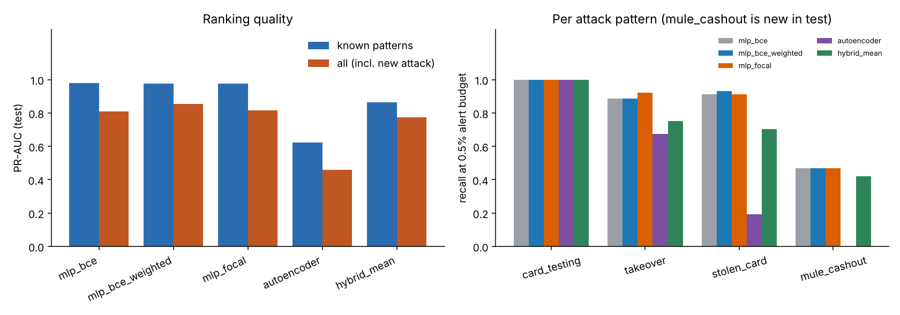

# fraud-detection-keras

Card-fraud detection with **Keras 3**: an embedding MLP, three ways of handling the class
imbalance, seed-to-seed variance, and an autoencoder used as an unsupervised detector, all
judged on a **later time period**, with a **review budget**, in **złoty**, and against an
attack that **did not exist in the training data**.

Part of a three-repository comparison on identical data and protocol:
[scikit-learn](https://github.com/Volers321/fraud-detection-sklearn) · **Keras** (this repo) · [TensorFlow](https://github.com/Volers321/fraud-detection-tensorflow).



## Protocol (same in all three repos)

* Synthetic card transactions from a simulator (`src/fraudkeras/data.py`): 2,500 cards, 90 days,
  **208,206 transactions, 0.51% fraud**, four attack patterns, hard negatives (trips, new phone,
  rare large purchases). No bank data, no real fraud rates.
* Temporal split: train days 0-59 (613 fraud rows), validation 60-74 (181), test 75-89 (270).
* `mule_cashout` (117 rows) appears **only in the test period**: a new attack.
* Features of a transaction use only earlier transactions of the same card; a test checks
  that removing future rows changes nothing.
* Alert threshold = the validation score that alarms 0.5% of transactions, applied unchanged to test.
* Net savings = amount of stopped fraud minus 5 PLN per reviewed alert.
* Confidence intervals: card-level bootstrap.

## The network

Numeric features (log1p on heavy-tailed ones, then standardised on the training block) plus learned
embeddings for `channel` (2-d) and `category` (4-d), two dense layers (64, 32) with batch
normalisation and dropout 0.2, sigmoid output. Early stopping watches PR-AUC on the later
validation block, never on a random split, which would leak the future.

## Results (test period, 34,556 transactions, 270 fraud)

| Model | PR-AUC all | PR-AUC known patterns | Recall | Precision | Alert rate | Net savings (PLN) | Fraud amount stopped |
|---|---:|---:|---:|---:|---:|---:|---:|
| MLP, plain BCE | 0.808 | **0.981** | 0.730 | 0.952 | 0.60% | 116,332 | 52.9% |
| MLP, BCE + class weight | **0.853** [0.767-0.925] | 0.977 | 0.733 [0.618-0.839] | 0.943 | 0.61% | 116,091 | 52.8% |
| MLP, focal loss | 0.815 | 0.976 | **0.737** | **0.952** | 0.60% | **116,976** | 53.2% |
| Autoencoder (legit rows only) | 0.460 | 0.623 | 0.333 | 0.407 | 0.64% | 13,252 | 6.5% |
| Hybrid (mean of MLP and AE ranks) | 0.773 [0.674-0.849] | 0.864 | 0.637 [0.531-0.734] | 0.789 | 0.63% | 101,432 | 46.2% |

*Known patterns* = PR-AUC computed without the `mule_cashout` rows. Seed 0 in the table.

Recall by attack pattern:

| Model | card_testing | takeover | stolen_card | **mule_cashout (new)** |
|---|---:|---:|---:|---:|
| MLP, plain BCE | 1.00 | 0.89 | 0.91 | 0.47 |
| MLP, class weight | 1.00 | 0.89 | 0.93 | 0.47 |
| MLP, focal | 1.00 | 0.92 | 0.91 | 0.47 |
| Autoencoder | 1.00 | 0.67 | 0.19 | **0.00** |
| Hybrid | 1.00 | 0.75 | 0.70 | 0.42 |

Seed variance of the class-weight MLP (3 seeds, mean ± std): PR-AUC 0.848 ± 0.004,
PR-AUC known patterns 0.976 ± 0.001, recall 0.712 ± 0.016, net savings 110,709 ± 3,819 PLN,
recall on the new attack 0.447 ± 0.016.

## What the results say

1. **A small MLP matches gradient boosting on known attacks.** PR-AUC on known patterns is 0.976-0.981
   here against 0.969 for `HistGradientBoosting` in the scikit-learn repo, on the same data. Embeddings
   and log-scaling did the work; depth did not matter. On overall PR-AUC boosting is ahead (0.90 vs 0.85).
2. **The imbalance strategy barely moves the ranking.** Plain BCE, a positive class weight and focal
   loss land within 0.005 of each other on known-pattern PR-AUC and within 1,000 PLN of each other in
   net savings. The weighted model stopped training after 17 epochs, the others after 37-40. The 0.04
   gap in *overall* PR-AUC in favour of the weighted loss is suggestive only: the other two
   variants ran with one seed.
3. **Neural results move with the seed, but here not by much.** Spreads of ±0.004 PR-AUC and ±0.016
   recall are small against the gaps between model families. For recall they are larger than the
   differences between the three loss variants (0.730-0.737), so one seed cannot rank those.
4. **The autoencoder failed on the new attack, and that is a result.** It catches the tiny
   `card_testing` bursts (recall 1.00) but none of the ATM cash-outs, and it makes the hybrid worse than the
   MLP alone (net savings 101,432 vs 116,091 PLN). In the scikit-learn repo an Isolation Forest catches
   86% of the same attack. My reading, not tested here: withdrawals of 1,000-2,000 PLN are not
   unusual enough in the reconstructed feature space (legitimate ATM amounts reach 1,000), whereas
   the forest isolates the burst pattern. The lesson is that "unsupervised" is not one thing: the
   detector has to be able to see the kind of anomaly it is meant to find.
5. **The limit is the data, not the library.** Every supervised variant finds 47% of the new attack,
   exactly what gradient boosting found. A model cannot learn a pattern that has no labels yet.

## Caveats

* **Synthetic data**: absolute numbers are a property of the simulator, not a claim about real fraud.
* **One simulated dataset (seed 0)**: intervals describe card-level sampling noise within it.
* The autoencoder is a simple 8-unit bottleneck; I did not tune it, so the negative result is for this
  configuration, not for autoencoders in general.
* The hybrid is the plain mean of two percentile ranks, declared before looking at results.
* Net savings ignores customer friction and the cost of blocking genuine payments.

## Run it

```bash
pip install -e ".[dev]"
fraudkeras eval            # trains 7 networks, writes results/eval.json and docs/eval.png (about 3 min on 2 CPU cores)
pytest                     # 12 tests
```

Keras 3 with the TensorFlow backend. Tests cover the no-leakage property, preprocessing fitted on
training rows only, equality of the numpy PR-AUC with a hand-computed value, every loss variant,
determinism for a fixed seed, and a smoke run of the whole pipeline.

## Layout

```
src/fraudkeras/data.py      simulator and point-in-time features (shared across the three repos)
src/fraudkeras/metrics.py   PR-AUC, alert budget, net savings, per-pattern recall, card bootstrap (shared)
src/fraudkeras/models.py    preprocessing, embedding MLP, loss variants, autoencoder
src/fraudkeras/pipeline.py  protocol, seed variance, hybrid
results/eval.json           every number in this README
```

MIT licence.
